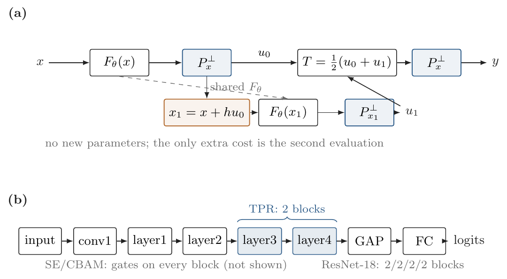

# A Cross-Condition Benchmark and Controlled Study for Facial Expression Recognition

Official code, selected weights, and paper sources for:

> **Rethinking Residual Geometry for Facial Expression Recognition: A Cross-Condition Benchmark and Controlled Study**

Author: **Weihang Yuan**  
Affiliation: School of Information Science and Technology, Beijing Forestry University  
Contact: yuanweihang810@gmail.com

---

## Why this repository

A facial expression model that looks strong on a clean benchmark can lose **more than ten points** when the camera, illumination, or resolution changes. Practitioners often respond by adding a gate (SE/CBAM) or making the network deeper, but these changes add parameters and do not consistently fix the failure.

This repository studies a different question: **can the residual update itself be made more robust without adding parameters or a gate?**

We introduce **Tangent-Path Residual (TPR)**:

    u0 = P_x_perp F(x),   x1 = x + h u0
    u1 = P_x1_perp F(x1)
    T  = (u0 + u1) / 2
    y  = x + h P_x_perp T

TPR projects the residual onto the tangent space at both evaluation points and integrates the tangent field with a trapezoidal rule. It has the **same parameter count as ResNet-18** and **no learned gate**. The only cost is a second residual evaluation (1.25x FLOPs).

The repository also releases **CC-FER**, an instance-disjoint cross-condition protocol:

- 1,512 instances (216 per class, 7 classes);
- 20 views per instance = 5 geometric transforms x 4 imaging conditions;
- 1,057 / 224 / 231 train / validation / test instances;
- two settings: **CC-FER-M** (all conditions in training) and **CC-FER-U** (train on standard only, test on unseen degraded conditions).

---

## Main results

### RAF-DB (5 seeds)

| Method | Params | Acc | UAR | ECE |
|---|---:|---:|---:|---:|
| Euler (ResNet-18) | 11.18M | **86.49** | 76.49 | 5.91 |
| OrthRes | 11.18M | 85.74 | 74.86 | 5.21 |
| HeunNet | 11.18M | 85.61 | 75.77 | 4.85 |
| **TPR** | 11.18M | 86.11 | 76.48 | 5.06 |
| TPR-nofinal | 11.18M | 85.91 | **76.59** | **4.84** |
| SE-ResNet-18 | 11.27M | 86.41 | 77.15 | 5.27 |
| CBAM-ResNet-18 | 11.27M | 85.27 | 75.23 | 5.57 |
| ResNet-34 | 21.30M | 86.60 | **78.01** | 4.97 |

### CC-FER-M (3 seeds, all conditions in training)

| Method | Standard | Dark | Bright | Low-res | Mean |
|---|---:|---:|---:|---:|---:|
| **TPR** | **73.02** | 72.61 | **72.87** | 71.83 | **72.58** |
| Euler | 72.47 | **73.42** | 71.83 | **71.86** | 72.40 |
| SE | 71.92 | 71.80 | 71.00 | 71.92 | 71.66 |
| ResNet-34 | 72.03 | 71.00 | 70.48 | 71.43 | 71.23 |
| CBAM | 70.82 | 71.34 | 71.52 | 68.83 | 70.63 |

### CC-FER-U (train on standard only, test on unseen conditions)

| Method | Standard | Dark | Bright | Low-res | Mean |
|---|---:|---:|---:|---:|---:|
| TPR | **72.41** | 61.50 | **60.35** | 56.97 | 62.81 |
| Euler | 72.38 | **63.46** | 57.78 | **57.72** | **62.84** |
| SE | 71.00 | 58.70 | 51.73 | 59.83 | 60.31 |

**Honest summary:** TPR is numerically best on CC-FER-M mean/standard/bright and is **+2.57 on bright** in the unseen-condition setting, but Euler is better on dark images and calibration. The paper reports both sides; there is no universal winner.

---

## Repository structure

    .
    |-- autodl_rafdb/
    |   |-- train_rafdb.py          # RAF-DB training (Euler/Orth/Heun/TPR/SE/CBAM/ResNet-34)
    |   |-- train_cale.py           # CC-FER training (M and U settings)
    |   |-- cale_data.py            # CC-FER scan / condition inference / instance split
    |   |-- rafdb_data.py           # RAF-DB official label-file loader
    |   |-- eval_checkpoint.py      # gamma/corruption evaluation
    |   |-- summarize_cale_seeds.py # multi-seed summary
    |   |-- summarize_pilot.py      # RAF-DB 2x2 summary
    |   |-- check_data.py           # RAF-DB integrity check
    |   |-- check_cale.py           # CC-FER condition check
    |-- tpr.py                      # TPR block / projection / ResNet conversion
    |-- baselines.py                # SE / CBAM wrappers
    |-- nrr.py                      # neutral-reference residual (auxiliary experiment)
    |-- weights/                    # selected checkpoints (see weights/README.md)
    |-- results/                    # summary tables and prediction analysis
    |-- figures/                    # architecture, concept, results
    |-- docs/                       # paper PDFs (TVC and IEEE Access versions)
    |-- data/README.md              # dataset links and layout
    |-- scripts/                    # example training commands

---

## Installation

    python -m venv .venv
    source .venv/bin/activate        # Windows: .venv\Scripts\activate
    pip install -r requirements.txt

Tested with Python 3.10+, PyTorch 2.x, torchvision 0.15+, and one RTX 4090. CPU evaluation works; CPU training is possible but slow.

Quick self-test of the TPR operator:

    python self_test.py

Expected: ALL PASS.

---

## Dataset

The dataset is **not** included in this repository.

- **Google Drive (training set):**  
  https://drive.google.com/file/d/1ZcVy0gQ59Sw704AxI2s99ZuSg5h4O38M/view?usp=drive_link
- **Google Drive (test set):**  
  https://drive.google.com/file/d/1oQP91wG6OMKK5C9Cob-4iYVCpDuTXUQZ/view?usp=drive_link
- **Zenodo (permanent archive, DOI):**  
  https://doi.org/10.5281/zenodo.23252243

Dataset description (from the dataset release):

> Training set: 30,240 images (7 emotions x 4 quality conditions, with 20 variants per source image).  
> Test set: 3,460 independently collected multi-label images.  
> The dataset is permanently archived on Zenodo. Model weights are available separately (see below).

### Expected layout

    data/CALE/data_aligned/
      angry/
        angry100_01.jpg
        angry100_02.png
        ...
      disgust/
      fear/
      happy/
      sad/
      surprise/
      natural/

The loader scans **both .jpg and .png**, groups files by the instance prefix (for example angry100), and infers the four conditions per instance from brightness and Laplacian energy. The _original image is forced to the standard condition.

RAF-DB layout:

    data/RAF-DB/
      Image/aligned/train_00001_aligned.jpg
      Image/aligned/test_00001_aligned.jpg
      EmoLabel/list_patition_label.txt

---

## Training

### RAF-DB

    python autodl_rafdb/train_rafdb.py \
      --root data/RAF-DB \
      --variant tpr --seed 0 --epochs 30 \
      --batch_size 64 --workers 4 \
      --out_dir runs/rafdb

Variants: euler, orth, heun, tpr, tpr_nofinal, se, cbam, resnet34.

### CC-FER-M (all conditions in training)

    python autodl_rafdb/train_cale.py \
      --root data/CALE/data_aligned \
      --variant tpr --seed 0 --epochs 30 \
      --train_conditions standard,dark,bright,lowres \
      --val_conditions standard,dark,bright,lowres \
      --batch_size 128 --workers 8 \
      --out_dir runs/cale_m

### CC-FER-U (train on standard only)

    python autodl_rafdb/train_cale.py \
      --root data/CALE/data_aligned \
      --variant tpr --seed 0 --epochs 30 \
      --train_conditions standard --val_conditions standard \
      --batch_size 128 --workers 8 \
      --out_dir runs/cale_u

The condition cache is created automatically next to the run output. To build it explicitly:

    python autodl_rafdb/check_cale.py \
      --root data/CALE/data_aligned \
      --cache cale_conditions.json

---

## Evaluation

Evaluate a checkpoint at gamma = 0 (Euler inference) and gamma = 1 (TPR inference):

    python autodl_rafdb/eval_checkpoint.py \
      --root data/RAF-DB \
      --ckpt weights/rafdb_tpr_seed0.pth \
      --gamma 1.0 --batch_size 64 --workers 4

The evaluation reports accuracy, UAR, macro-F1, ECE, Brier, and NLL, with optional occlusion/noise/blur corruption.

---

## Weights

Selected checkpoints are in weights/:

| File | Dataset / setting | Role |
|---|---|---|
| rafdb_tpr_seed0.pth | RAF-DB | TPR, seed 0 |
| rafdb_euler_seed0.pth | RAF-DB | Euler baseline, seed 0 |
| rafdb_se_seed0.pth | RAF-DB | SE-ResNet-18, seed 0 |
| rafdb_cbam_seed0.pth | RAF-DB | CBAM-ResNet-18, seed 0 |
| rafdb_resnet34_seed0.pth | RAF-DB | ResNet-34, seed 0 |
| cale_m_tpr_seed0.pth | CC-FER-M | TPR, seed 0 |
| cale_m_euler_seed0.pth | CC-FER-M | Euler, seed 0 |
| cale_u_tpr_seed0.pth | CC-FER-U | TPR, seed 0 |
| cale_u_euler_seed0.pth | CC-FER-U | Euler, seed 0 |

The checkpoints store model, variant, args, and classes. Load with:

    import torch
    ckpt = torch.load("weights/rafdb_tpr_seed0.pth", map_location="cpu")
    print(ckpt["variant"], ckpt["args"]["seed"])

---

## Results files

- results/rafdb_summary.md — RAF-DB 5-seed table and 2x2 interaction;
- results/cale_m_summary.md — CC-FER-M 3-seed table;
- results/cale_u_summary.md — CC-FER-U table;
- results/rafdb_prediction_analysis.md — per-class recall/UAR/ECE;
- results/CCFER_RESULTS.md — combined report.

---

## Papers

- docs/paper_tvc.pdf — The Visual Computer version (12 pages);
- docs/paper_ieee_access.pdf — IEEE Access fallback version (6 pages).

The TVC version is the primary submission. The IEEE Access version is a content-ready fallback; if the portal requires the official ieeeaccess.cls, only the preamble/author block needs conversion.

---

## Citation

If you use this code, the CC-FER protocol, or the weights, please cite:

    @article{yuan2026tpr,
      title={Rethinking Residual Geometry for Facial Expression Recognition:
             A Cross-Condition Benchmark and Controlled Study},
      author={Yuan, Weihang},
      year={2026},
      note={Manuscript}
    }

Dataset:

    @misc{yuan2026cale,
      title={{CALE}: A Cross-Condition Facial Expression Dataset},
      author={Yuan, Weihang},
      year={2026},
      doi={10.5281/zenodo.23252243}
    }

---

## License

Code is released under the MIT License (see LICENSE).  
The dataset is archived on Zenodo; please follow the license/terms stated there.

## Contact

Weihang Yuan — yuanweihang810@gmail.com  
GitHub: https://github.com/yuanweihang810/A-Cross-Condition-Benchmark-and-Controlled
